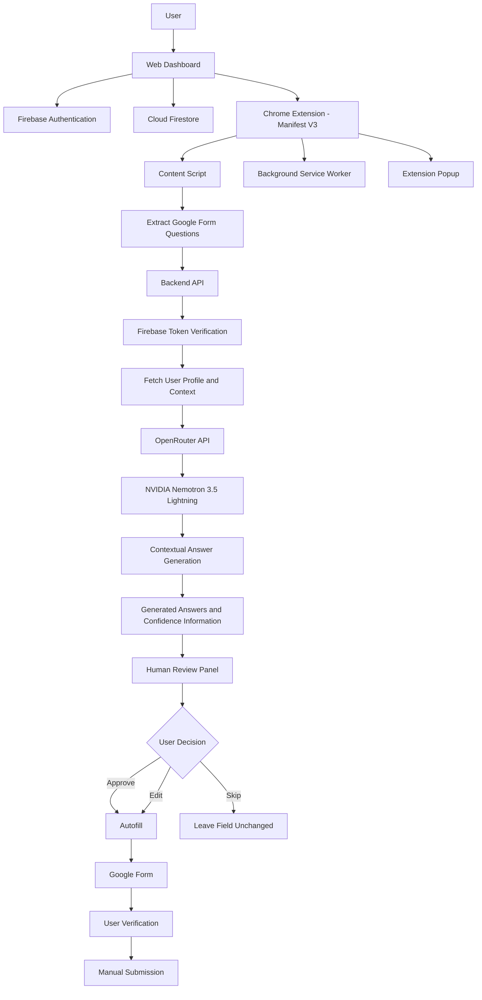

# FormPilot 
### Intelligent AI-Powered Form Assistance & Autofill System

<p align="center">
  <strong>Fill your profile once. Use it across supported Google Forms.</strong>
</p>

<p align="center">
  An AI-powered Chrome Extension that understands form questions, generates contextual answers using reusable user profiles, and assists with autofilling through a Human-in-the-Loop workflow.
</p>


---

## 📌 Overview

FormPilot is an intelligent web-form assistance system designed to reduce repetitive manual form filling for students, job seekers, interns, and professionals.

People frequently enter the same personal, academic, and professional information while applying for internships, jobs, scholarships, hackathons, and other opportunities.

Traditional browser autofill tools mainly rely on saved values and recognized field names. They may struggle when the same information is requested using different wording or context-dependent questions.

FormPilot addresses this challenge using Large Language Models (LLMs), semantic question understanding, reusable user profiles, and contextual answer generation.

Instead of simply matching field names, FormPilot attempts to understand what a form question means, identify relevant profile information, and generate an appropriate response.

**Most importantly, users remain in control.** Every generated answer can be reviewed, edited, or skipped before autofilling. Final form submission is always performed manually by the user.

## 🎯 Problem Statement

Users repeatedly enter personal, academic, and professional information across different online forms.

This creates several challenges:

- Repetitive data entry.
- Time-consuming application processes.
- Different wording for similar questions.
- Inconsistent answers across applications.
- Difficulty identifying relevant information from resumes.
- Possibility of incorrect or incomplete form responses.

FormPilot aims to simplify this process through intelligent, profile-based form assistance.

## ✨ Key Features

### 1. User Authentication and Profile Management

- User registration and login.
- Firebase Authentication.
- Reusable user profiles.
- Personal, academic, and professional information management.
- Structured profile storage.
- Profile completeness management.

### 2. Resume Upload and Profile Extraction

- PDF resume upload.
- AI-assisted information extraction.
- Conversion of relevant resume information into structured profile data.
- Reusable information for future form responses.

### 3. Intelligent Chrome Extension

- Chrome Extension built using Manifest V3.
- Detects supported Google Forms.
- Extracts form questions and field information.
- Identifies supported question and input types.
- Communicates with the backend API.
- Displays the FormPilot review interface.

### 4. Semantic Question Understanding

FormPilot uses LLM-based reasoning to understand questions based on their meaning and context rather than relying exclusively on exact field-name matching.

For example:

| Form question | Relevant profile information |
|---|---|
| What is your highest qualification? | Education |
| Which programming languages do you know? | Technical skills |
| Describe your technical experience. | Projects and experience |
| Share your professional profile. | LinkedIn URL |
| What technologies have you worked with? | Skills and projects |

### 5. AI-Based Answer Generation

- OpenRouter API integration.
- NVIDIA Nemotron 3.5 Lightning model.
- Contextual answer generation.
- Structured JSON responses.
- Confidence information.
- Source and provenance information.
- Profile-based personalization.

### 6. Human-in-the-Loop Review

FormPilot does not blindly fill every generated answer.

Users can:

- **Approve:** Accept the generated answer.
- **Edit:** Modify the suggested answer.
- **Skip:** Ignore a question.

The review panel also displays confidence information and source details to help users make informed decisions.

### 7. Automated Form Filling

After reviewing the generated responses, users can autofill supported Google Forms fields.

Supported field categories include:

- Text fields.
- Date fields.
- Multiple-choice questions.
- Checkboxes.
- Dropdowns.
- Grid-based questions.

Actual compatibility may depend on the form structure and supported field configuration.

### 8. Manual User Submission

FormPilot follows a Human-in-the-Loop approach.

- Users review generated answers.
- Users decide which answers to autofill.
- Users verify the completed form.
- Final submission remains a manual user action.

**FormPilot does not autonomously submit forms.**

---

## 🏗️ System Architecture

FormPilot consists of a web dashboard, Firebase services, a Chrome extension, a backend API, and an AI reasoning layer.

### Architecture Overview



### Architecture Components

| Component | Responsibility |
|---|---|
| User | Creates and manages their profile |
| Web Dashboard | Profile management and resume upload |
| Firebase Authentication | User authentication |
| Cloud Firestore | Profile and related data storage |
| Chrome Extension | Form detection, extraction, review and autofill |
| Background Service Worker | Extension coordination and API communication |
| Content Script | Google Forms interaction |
| Backend API | Authentication verification, prompt construction and response processing |
| OpenRouter | AI model API access |
| NVIDIA Nemotron 3.5 Lightning | Contextual answer generation |
| Review Panel | Human verification and answer editing |

---

## 🔄 How FormPilot Works

1. **Create an Account:** Users register and access their FormPilot dashboard.
2. **Build a Profile:** Users enter personal, academic, and professional information.
3. **Upload Resume:** Users can upload a PDF resume for structured profile extraction.
4. **Open Google Forms:** Users navigate to a supported Google Form.
5. **Detect Form Questions:** The Chrome extension extracts available questions and field information.
6. **Analyze Questions:** The extracted questions and relevant context are sent to the backend.
7. **Generate Answers:** The AI reasoning layer generates contextual responses.
8. **Review Answers:** Users inspect the generated responses, confidence information, and sources.
9. **Approve, Edit, or Skip:** Users decide how each answer should be handled.
10. **Autofill:** Approved and edited answers are inserted into supported form fields.
11. **Verify and Submit:** Users verify all responses and manually submit the form if they choose.

---

## 🛠️ Technology Stack

| Category | Technologies |
|---|---|
| Programming Languages | TypeScript, JavaScript |
| Frontend Framework | Next.js 16, React 19 |
| UI Styling | Tailwind CSS |
| Browser Extension | Chrome Extension Manifest V3 |
| Extension Build Tools | Vite, React |
| Authentication | Firebase Authentication |
| Database | Cloud Firestore |
| Backend | Next.js App Router API Routes |
| Backend Services | Firebase Admin SDK |
| AI Integration | OpenRouter API |
| AI Model | NVIDIA Nemotron 3.5 Lightning |
| Resume Processing | PDF upload and AI-assisted extraction |
| Version Control | Git and GitHub |

---

## 📂 Project Structure

The following is a conceptual project organization. Refer to the actual repository for the exact folder and file names.

```text
FormPilot/
│
├── frontend/
│   ├── app/
│   ├── components/
│   ├── public/
│   ├── services/
│   └── ...
│
├── extension/
│   ├── manifest.json
│   ├── popup/
│   ├── background/
│   ├── content/
│   ├── components/
│   └── assets/
│
├── backend/
│   ├── API Routes
│   ├── Authentication
│   ├── AI Integration
│   └── Response Processing
│
├── public/
│
├── package.json
├── README.md
└── .gitignore
```

---

## ⚙️ Installation and Setup

### Prerequisites

Before running FormPilot, ensure that you have:

- Node.js and npm installed.
- Google Chrome browser.
- Git installed.
- Firebase project configured.
- OpenRouter API account and API key.
- Access to the configured NVIDIA Nemotron model through OpenRouter.

### 1. Clone the Repository

```bash
git clone https://github.com/SAITEJA0217/FormPilot-AI.git
```

Navigate into the repository:

```bash
cd FormPilot-AI
```

### 2. Install Dependencies

Navigate to the relevant application directories and install their dependencies.

```bash
npm install
```

If the frontend and extension have separate package files, install their dependencies separately.

### 3. Configure Environment Variables

Create the required environment configuration files based on the application's existing configuration.

Typical configuration values may include:

```env
# Firebase Configuration
NEXT_PUBLIC_FIREBASE_API_KEY=
NEXT_PUBLIC_FIREBASE_AUTH_DOMAIN=
NEXT_PUBLIC_FIREBASE_PROJECT_ID=
NEXT_PUBLIC_FIREBASE_STORAGE_BUCKET=
NEXT_PUBLIC_FIREBASE_MESSAGING_SENDER_ID=
NEXT_PUBLIC_FIREBASE_APP_ID=

# Server-Side Configuration
FIREBASE_ADMIN_PROJECT_ID=
FIREBASE_ADMIN_CLIENT_EMAIL=
FIREBASE_ADMIN_PRIVATE_KEY=

# AI Configuration
OPENROUTER_API_KEY=
```

**Important:**

- Use the exact environment variable names expected by the source code.
- Never commit `.env` files or service-account credentials.
- Keep OpenRouter API credentials on the server side.
- Do not expose private API keys in the Chrome extension.
- Configure Firebase Authentication, Firestore rules, and authorized domains before testing.
- Use appropriate access restrictions and security rules for user data.

### 4. Run the Web Dashboard

Navigate to the frontend application directory and use the scripts defined in its `package.json`.

For example:

```bash
npm run dev
```

Open the local URL displayed in the terminal.

### 5. Build the Chrome Extension

Navigate to the extension directory and install its dependencies.

Run the build command defined in its `package.json`.

For example:

```bash
npm run build
```

The compiled extension directory should contain a valid `manifest.json`.

### 6. Install the Extension in Chrome

1. Open Google Chrome.
2. Navigate to:

```text
chrome://extensions
```

3. Enable Developer mode.
4. Click **Load unpacked**.
5. Select the compiled extension directory containing `manifest.json`.
6. Pin FormPilot to your Chrome toolbar.
7. Open a supported Google Form and test the extension.

---

## 🔐 Privacy and Security

FormPilot handles information that may include personal, academic, and professional details. Responsible data handling is therefore an important part of the system.

Our design considerations include:

- Firebase Authentication for account access.
- Firebase ID token verification in backend requests.
- HTTPS communication with supported backend and AI services.
- Server-side handling of AI API credentials.
- Controlled access to user profile information.
- Review of generated answers before autofilling.
- Manual user control over final form submission.
- Avoiding unnecessary sharing of personal information with external AI services.

### Important Privacy Considerations

FormPilot uses an external AI service through OpenRouter. Information included in AI requests may be processed by the selected provider according to its applicable policies and configuration.

Users should avoid submitting unnecessary sensitive information.

FormPilot's human-review workflow helps users verify answers, but it does not guarantee that every generated answer is accurate or that all privacy risks are eliminated.

---

## 🧪 Testing and Evaluation

FormPilot should be evaluated using representative Google Forms and different question types.

Suggested evaluation parameters:

| Parameter | Evaluation objective |
|---|---|
| Form Detection | Ability to detect supported Google Forms |
| Question Extraction | Correctness of extracted questions |
| Semantic Understanding | Ability to understand differently worded questions |
| Answer Generation | Relevance of AI-generated answers |
| Confidence Information | Usefulness of confidence indicators |
| Source Information | Traceability of generated responses |
| Autofill Accuracy | Correctness of populated fields |
| User Experience | Ease of installation and operation |
| Time Efficiency | Comparison with manual form filling |

### Real-World Beta Testing

We plan to evaluate FormPilot with external users to understand its usability, reliability, and practical usefulness.

Feedback will help identify:

- Incorrect question mappings.
- Irrelevant AI-generated answers.
- Unsupported field types.
- Autofill failures.
- User experience problems.
- Privacy and security concerns.

Actual evaluation results will be documented after testing.

---

## ⚠️ Current Limitations

FormPilot is currently focused on supported Google Forms.

Known scope limitations include:

- Microsoft Forms integration is not currently part of the implementation.
- Universal support for all website forms is not available.
- Compatibility may vary with complex or unusual Google Forms structures.
- AI-generated responses may occasionally be incorrect or incomplete.
- AI-based answer generation requires internet connectivity and access to the configured API.
- External AI processing introduces additional data-handling considerations.
- Final form submission requires manual user action.

---

## 🚀 Future Enhancements

The following features are planned for future development:

### 1. Microsoft Forms Integration

Extend compatibility to Microsoft Forms.

### 2. Universal Web Form Support

Explore support for other online form platforms, including registration, internship, job, and scholarship application forms.

### 3. Advanced Semantic Matching

Improve question understanding and field mapping for diverse labels, layouts, and question formats.

### 4. Improved Answer Reliability

Enhance answer validation, confidence estimation, source attribution, and contextual relevance.

### 5. Graph-Based Dependency Reasoning

Explore Graph Neural Network-based reasoning to identify relationships between dependent form fields.

For example:

```text
Degree
  |
  v
University
  |
  v
Graduation Year
```

This is a proposed research enhancement, not a currently implemented GNN feature.

### 6. Enhanced Privacy and Security

Continue improving data minimization, access control, secure processing, and user privacy.

---

## 🎓 Academic Project Information

**Project Title:**

Semantic Matching and Evidence-Based Decision-Making for Web Forms Using LLM-Based Reasoning

**Project Name:** FormPilot

**Project Type:** Major Project – B.Tech Artificial Intelligence and Machine Learning

**Institution:** Malla Reddy University

**Department:** Artificial Intelligence and Machine Learning

**Academic Year:** 2026–2027

**Project Guide:** Dr. P. Bhavani, Assistant Professor

### Project Team

| Student | Roll Number |
|---|---|
| Kadiyala Preethi | 2311cs020290 |
| Kalangi Samhitha | 2311cs020297 |
| Karka Sai Teja Reddy | 2311cs020312 |

---

## 🤝 Contributing

We welcome feedback, suggestions, and contributions that can improve FormPilot.

If you would like to contribute:

1. Fork the repository.
2. Create a new feature branch.
3. Make your changes.
4. Test the changes locally.
5. Submit a pull request with a clear description.

For bug reports and feature suggestions, please open an issue in the GitHub repository.

---

## 🐛 Reporting Issues

If you encounter an issue while using FormPilot, please provide:

- Browser and operating system details.
- Description of the issue.
- Steps to reproduce the problem.
- Expected behaviour.
- Actual behaviour.
- Screenshots or error messages, with personal information removed.

Please never include API keys, passwords, private profile information, or sensitive form data in public GitHub issues.

---

## 📌 Project Status

**FormPilot is under active development and beta testing preparation.**

The core implementation includes:

- User authentication and profile management.
- Resume upload and profile extraction.
- Manifest V3 Chrome Extension.
- Supported Google Forms detection and question extraction.
- LLM-based contextual answer generation.
- Confidence and source information.
- Human-in-the-Loop review.
- Autofill of supported Google Forms fields.
- Manual final form submission.

Additional platform support, advanced evaluation, and enhanced reasoning capabilities are planned improvements.

---

## 📄 License

No open-source license has currently been specified for this repository.

Until a license is added, all rights remain with the respective copyright holders. Please contact the project maintainers before redistributing or commercially using the project.

---

## 💬 Contact and Project Links

**GitHub Repository:**  
https://github.com/SAITEJA0217/FormPilot-AI

**Project Website:**  
Add your official FormPilot website URL here.

**Project Maintainer:**  
Saiteja Reddy Karka

---

<p align="center">
  <strong>FormPilot – Fill Your Profile Once. Use It Everywhere.</strong>
  <br/>
  Built to make online form filling smarter, faster, and more user-controlled. 🚀
</p>
