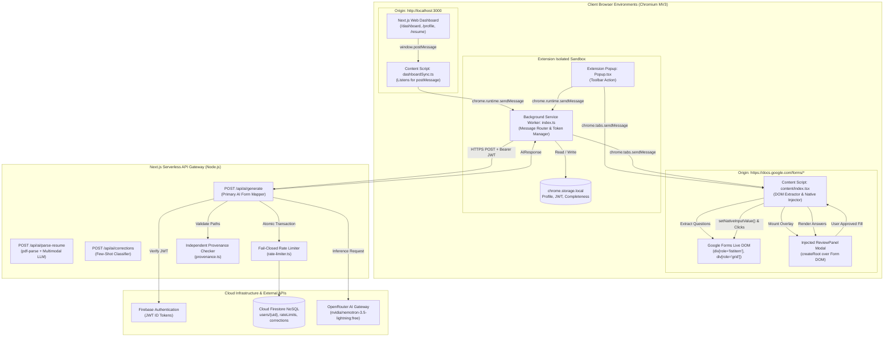
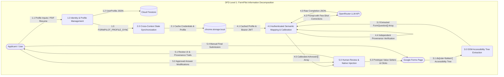
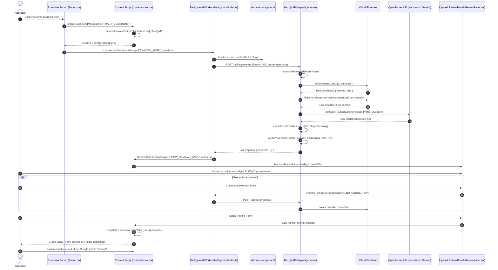

# FormPilot AI: Technical Architecture & System Specification

> **Document:** `project-report-audit/TECHNICAL_ARCHITECTURE.md`  
> **Repository:** [`c:/P/formpilot`](file:///c:/P/formpilot)  
> **Institution:** Malla Reddy University — Department of CSE-AIML  
> **Academic Level:** B.Tech Major Project Phase-I  
> **Auditor Status:** Senior Software Architect / Academic Documentation Specialist  

---

## 1. System Architectural Overview

FormPilot AI is architected as a **distributed, multi-context hybrid client-server system** spanning four isolated runtime environments. It decouples the security-sensitive operations (authentication verification, AI model credentials, atomic rate limiting, and few-shot correction classification) from client-side DOM inspection and input automation.

```
┌────────────────────────────────────────────────────────────────────────────────────────┐
│                              FORMPILOT RUNTIME TOPOLOGY                                │
│                                                                                        │
│  ┌───────────────────────┐                    ┌─────────────────────────────────────┐  │
│  │   Chromium Browser    │                    │         Next.js Full-Stack          │  │
│  │   Client Context      │                    │         Serverless Gateway          │  │
│  │                       │                    │                                     │  │
│  │  ┌─────────────────┐  │                    │  ┌───────────────────────────────┐  │  │
│  │  │ Extension Popup │  │                    │  │ Web Dashboard App Router      │  │  │
│  │  └────────┬────────┘  │                    │  │ (/dashboard, /profile, /login)│  │  │
│  │           │           │                    │  └──────────────┬────────────────┘  │  │
│  │  ┌────────▼────────┐  │  HTTPS REST + JWT  │  ┌──────────────▼────────────────┐  │  │
│  │  │Background Worker│──┼───────────────────►│  │ Next.js API Routes            │  │  │
│  │  │(Service Worker) │  │                    │  │ (/api/ai/generate, etc.)      │  │  │
│  │  └────────┬────────┘  │                    │  └──────┬─────────────────┬──────┘  │  │
│  │           │           │                    └─────────┼─────────────────┼─────────┘  │
│  │  ┌────────▼────────┐  │                              │ gRPC            │ HTTPS      │
│  │  │ Content Scripts │  │                              ▼                 ▼            │
│  │  │ & ReviewPanel   │  │                    ┌──────────────────┐  ┌──────────────┐   │
│  │  └────────┬────────┘  │                    │ Cloud Firestore  │  │ OpenRouter   │   │
│  │           │ Native DOM│                    │ (NoSQL Database) │  │ AI API       │   │
│  │  ┌────────▼────────┐  │                    └──────────────────┘  └──────────────┘   │
│  │  │ Google Forms DOM│  │                                                             │
│  │  └─────────────────┘  │                                                             │
│  └───────────────────────┘                                                             │
└────────────────────────────────────────────────────────────────────────────────────────┘
```

---

## 2. Five Verified Architectural Diagrams

### Diagram 1: High-Level System Architecture Diagram


---

### Diagram 2: End-to-End User Workflow Diagram

```mermaid
flowchart TD
    Start([User Starts Application]) --> Step1[Open Web Dashboard at localhost:3000]
    Step1 --> Step2{User Authenticated?}
    Step2 -- No --> Step3[Sign In via Google or Email/Password]
    Step3 --> Step4[Firebase Issues Session ID Token]
    Step2 -- Yes --> Step4
    Step4 --> Step5[Upload PDF Resume or Edit 6-Tab Profile]
    Step5 --> Step6[Profile Saved to Firestore & Caching Triggered]
    Step6 --> Step7[postMessage Syncs Profile & JWT to chrome.storage.local]
    Step7 --> Step8[User Navigates to Google Form Tab]
    Step8 --> Step9[User Opens Extension Popup & Clicks 'Analyze Current Form']
    Step9 --> Step10[Content Script Scans div role='listitem' & Flattens 2D Grids]
    Step10 --> Step11[Background Worker Proxies Request to Next.js API]
    Step11 --> Step12[API Verifies JWT, Enforces Rate Limit, Calls OpenRouter]
    Step12 --> Step13[Server Verifies Provenance & Clamps Inferred Confidence <= 70%]
    Step13 --> Step14[Injected ReviewPanel Displays Suggested Answers & 'Why?' Links]
    Step14 --> Step15{User Edits or Skips Answers?}
    Step15 -- Yes --> Step16[Inline Edit Saved & Correction Sent to Firestore]
    Step16 --> Step17[User Clicks 'Autofill Form' Button]
    Step15 -- No --> Step17
    Step17 --> Step18[Native Prototype Setter Injects Values & Dispatches Bubbling Events]
    Step18 --> Step19[Green Success Toast: 'Form autofilled: X fields completed!']
    Step19 --> Step20[Applicant Manually Reviews Form and Clicks Google 'Submit']
    Step20 --> Finish([End of Transaction: Zero Autonomous Submissions])
```


---

### Diagram 3: Data-Flow Diagram (Level 0 Context & Level 1 Detailed)


---

### Diagram 4: Detailed Sequence Diagram


---

### Diagram 5: Semantic Field-Mapping Decision Process Flowchart
```mermaid
flowchart TD
    StartQuestion([Form Question Evaluated]) --> CheckGrid{Is Control a div role='grid'?}
    CheckGrid -- Yes --> FlattenGrid[Flatten Columns & Rowheaders into Discrete Sub-Questions]
    FlattenGrid --> PromptAssembly
    CheckGrid -- No --> ClassifyControl[Identify Control: short_answer, paragraph, radio, checkbox, dropdown, date, time]
    ClassifyControl --> PromptAssembly[Assemble System Prompt + Profile + Questions]

    PromptAssembly --> CallLLM[Execute OpenRouter Inference with 30s Timeout]
    CallLLM --> ExtractJSON[7-Stage Resilient JSON Parser & Markdown Cleaner]
    ExtractJSON --> ForEachAnswer[Iterate Parsed Candidate Answers]

    ForEachAnswer --> CheckAnswerNull{Is Answer Null or Empty?}
    CheckAnswerNull -- Yes --> MarkMissing[Set source='missing', confidence=0%]
    CheckAnswerNull -- No --> CheckSourceDetail{Does Answer Claim sourceDetail Path?}

    CheckSourceDetail -- No --> MarkGenerated[Set source='generated', Clamp Confidence <= 70%]
    CheckSourceDetail -- Yes --> DynamicTraversal[Resolve getNestedValue Profile Path]

    DynamicTraversal --> PathExists{Path Exists & Values Match?}
    PathExists -- Yes --> CheckGenerativeFlag{Did Model Set isGenerated=true?}
    CheckGenerativeFlag -- No --> MarkVerified[Set source='profile', Confidence >= 85%]
    CheckGenerativeFlag -- Yes --> MarkGenerated
    PathExists -- No --> MarkGenerated

    MarkMissing --> TieredMatching
    MarkGenerated --> TieredMatching
    MarkVerified --> TieredMatching[Tiered DOM Field Matcher]

    TieredMatching --> MatchTier1{Exact String Match?}
    MatchTier1 -- Yes --> MatchSuccess[Execute Native Injection]
    MatchTier1 -- No --> MatchTier2{Normalized Clean Match?}
    MatchTier2 -- Yes --> MatchSuccess
    MatchTier2 -- No --> MatchTier3{Jaccard Token Similarity >= 0.8 AND |Candidates| == 1?}
    MatchTier3 -- Yes --> MatchSuccess
    MatchTier3 -- No --> MatchFail[Skip Field: Fail Safe for Manual User Completion]
```

---

## 3. Academic Explanations of Architecture and Workflows

### 3.1 Explanation of System Architecture (Diagram 1)
The architecture conforms to the **Separation of Concerns (SoC)** and **Defense in Depth** principles. Untrusted client contexts (content scripts running inside arbitrary web pages) are barred from directly storing administrative secrets or making unthrottled calls to external LLM providers. 

The Next.js App Router serves as an **authenticated API Gateway**. All client invocations require a cryptographically signed Firebase ID Token (JWT). The API gateway handles resource governance: atomic daily quota transactions in Firestore prevent denial-of-wallet attacks, prompt-sanitization routines strip angle brackets to defeat indirect injection attacks, and server-side provenance algorithms mathematically verify whether answers originated from profile facts or generative inference.

### 3.2 Explanation of End-to-End Workflow (Diagram 2)
The application follows a linear, safe Human-in-the-Loop workflow. Prior to interacting with any third-party form, the user establishes a centralized identity record in the dashboard. Synchronization occurs via `window.postMessage` bridging to `chrome.storage.local`. 

When a Google Form is opened, the extension parses the accessibility tree, flattens matrix grids, and coordinates inference via the background service worker. The resulting answers are rendered in an injected on-screen React modal. Because FormPilot strictly adheres to a **Zero Autonomous Submission Policy**, the extension never clicks the Google Forms "Submit" button; it performs native input population and hands final submission control to the user.

### 3.3 Explanation of Data-Flow Decomposition (Diagram 3)
The Level 1 Data-Flow Diagram tracks the transformation of raw information through five processing modules:
1. `Process 1.0` ingests unstructured PDF text via `pdf-parse` or multimodal vision models and populates the 6-tab profile schema.
2. `Process 2.0` syncs profile state and JWT credentials to local extension storage.
3. `Process 3.0` extracts `div[role="listitem"]` containers from Google Forms.
4. `Process 4.0` enriches the extracted questions with few-shot corrections, runs OpenRouter LLM inference, and enforces independent provenance validation.
5. `Process 5.0` presents answers inside the `ReviewPanel`, records user phrasing adjustments back to Firestore, and writes values into the DOM using native prototype setters.

### 3.4 Explanation of Sequence Diagram (Diagram 4)
The sequence diagram models the temporal communication across runtime boundaries:
- The popup initiates question extraction via asynchronous tab messaging (`EXTRACT_QUESTIONS`).
- The content script inspects the DOM and returns structured `FormQuestion[]` objects.
- The background service worker attaches the cached session token and proxies the payload to `/api/ai/generate`.
- The Next.js API enforces rate limits, queries past corrections, calls OpenRouter, and executes confidence clamping.
- Injected `ReviewPanel` handles user approval and invokes `setNativeInputValue()` to populate fields.

### 3.5 Explanation of Field-Mapping Decision Process (Diagram 5)
The field-mapping flowchart captures the hybrid decision rules governing answer attribution:
- 2D rating tables are flattened by concatenating column headers with row titles.
- Model inferences claiming direct profile attribution (`sourceDetail`) are dynamically validated against the user profile. If the claimed path is ungrounded or contradictory, confidence is capped at 70%.
- On the browser DOM side, fields are mapped using a 3-tier algorithm: Exact match $\rightarrow$ Normalized alphanumeric match $\rightarrow$ Unambiguous Jaccard similarity ($\ge 0.8$). If ambiguity or subset collision is detected, the field fails safe (abtains), leaving the input blank for manual review.
